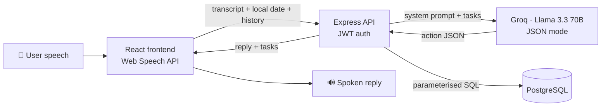

# VoiceTask


-F55036)


A voice-first task manager: speak naturally, and an LLM turns what you say into tasks. Full-stack, deployed, and built end to end — speech UI, REST API, auth, database and LLM integration.

## Highlights

- **Natural-language → structured actions:** the LLM returns strict JSON (`create`, `create_many`, `update`, `delete`, `read`) that the backend validates and executes against PostgreSQL
- **Conversation memory:** recent turns are sent back to the model, so "change the previous one to 6 PM" works
- **Safe by design:** deletes always require a spoken yes/no confirmation; every query is scoped to the logged-in user; client-supplied history can't inject system prompts
- **Real-time voice UX:** Web Speech API for recognition, SpeechSynthesis for replies, barge-in (talk over the assistant to interrupt it)
- **Production concerns handled:** JWT auth with bcrypt, retry on cold-start of the free-tier backend, timezone-correct dates

## Architecture




## Live Demo
🌐 [Open the app](https://voice-task-manager-xi.vercel.app)

Open it in **Chrome on a desktop**, sign up, click the orb and start talking.

> The backend runs on a free server and may take ~30 seconds to wake up on the first request. After that it works instantly.

## How it works

Just speak naturally — no commands to memorize.

- *"Create a task for team sync at 10 AM"*
- *"What's on my schedule today?"*
- *"Move the LinkedIn post to tomorrow evening"*
- *"Delete the gym task"* → confirms before deleting
- *"Actually change the previous one to 6 PM"* → remembers context
- *"Add gym at 7, standup at 9, and lunch at noon"* → creates all three at once

If you start talking while the assistant is speaking, it stops and listens. Feels like a real conversation.

## Features

- Voice-only task management — no buttons, no typing
- AI responds back with voice
- Context-aware — understands "the previous one" and "my evening task"
- Interruption handling — speak while AI is talking to redirect it
- Confirms before deleting tasks
- Signup, login and session handling
- Time-aware — understands today, tomorrow, morning, evening

## Tech Stack

| Layer | Tech |
|---|---|
| Frontend | React + Vite |
| Backend | Node.js + Express |
| Database | PostgreSQL |
| AI | Groq (Llama 3.3 70B) |
| Speech to Text | Web Speech API |
| Text to Speech | SpeechSynthesis API |
| Auth | JWT |
| Deployment | Vercel + Render + Neon |

## Local Setup

### Requirements
- Node.js v18+
- PostgreSQL
- Chrome browser
- Free Groq API key from [console.groq.com](https://console.groq.com)

### 1. Clone the repo
```bash
git clone https://github.com/nourebiddd/voice-task-manager.git
cd voice-task-manager
```

### 2. Set up the database
```bash
createdb voice_tasks
psql voice_tasks -f backend/schema.sql
```

### 3. Start the backend
```bash
cd backend
npm install
```
Create a `.env` file inside the backend folder:
```env
GROQ_API_KEY=your_groq_key_here
DATABASE_URL=postgresql://your_user@localhost:5432/voice_tasks
PORT=3001
JWT_SECRET=a_long_random_string   # e.g. `openssl rand -hex 32`
```
Then:
```bash
npm run dev
```

### 4. Start the frontend
```bash
cd frontend
npm install
npm run dev
```

Open **http://localhost:5173** in Chrome and start talking!

## Notes

- Chrome is required — does not work on Safari or mobile
- On first load the backend may take ~30 seconds to wake up (free tier)
